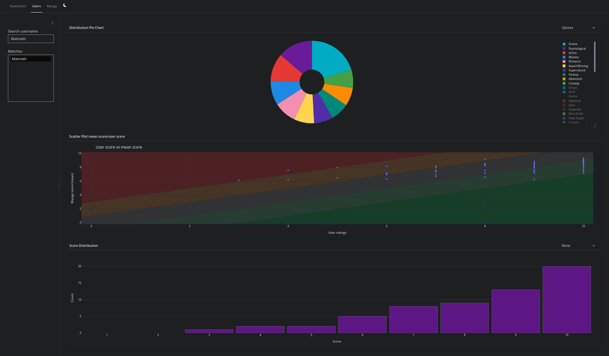
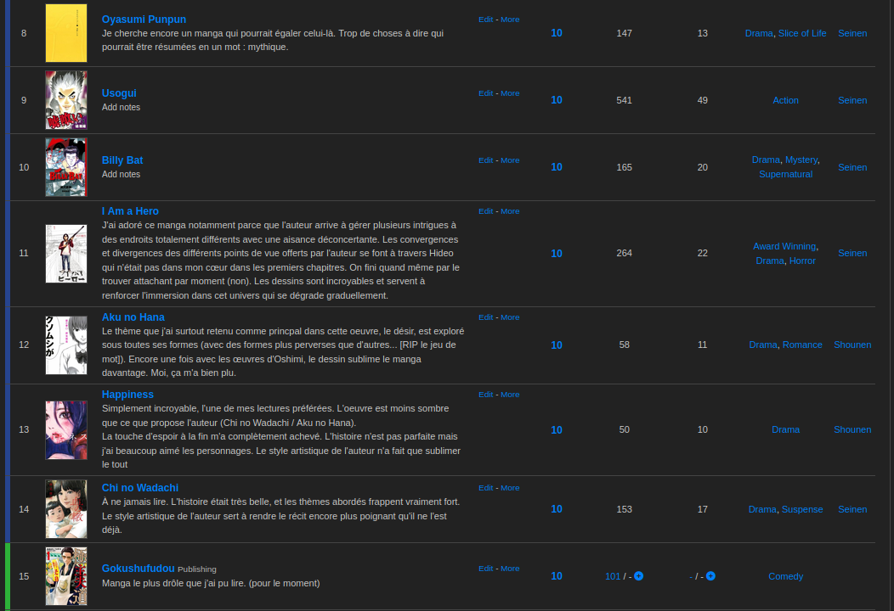
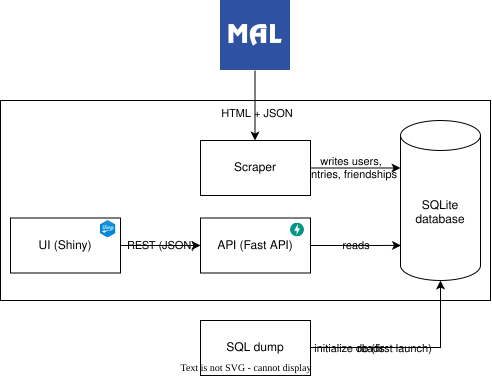
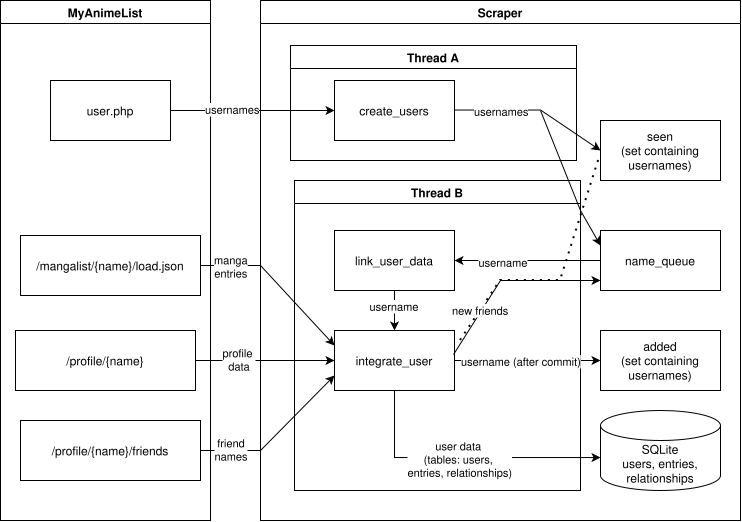
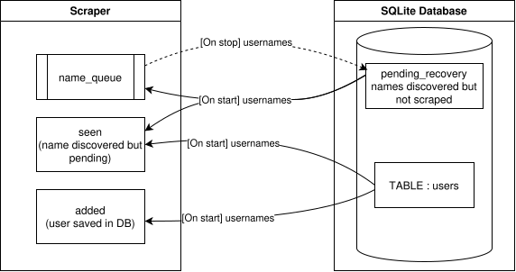
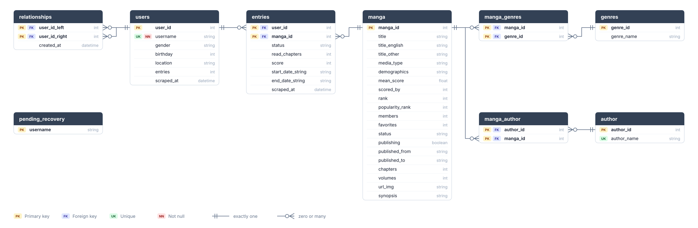
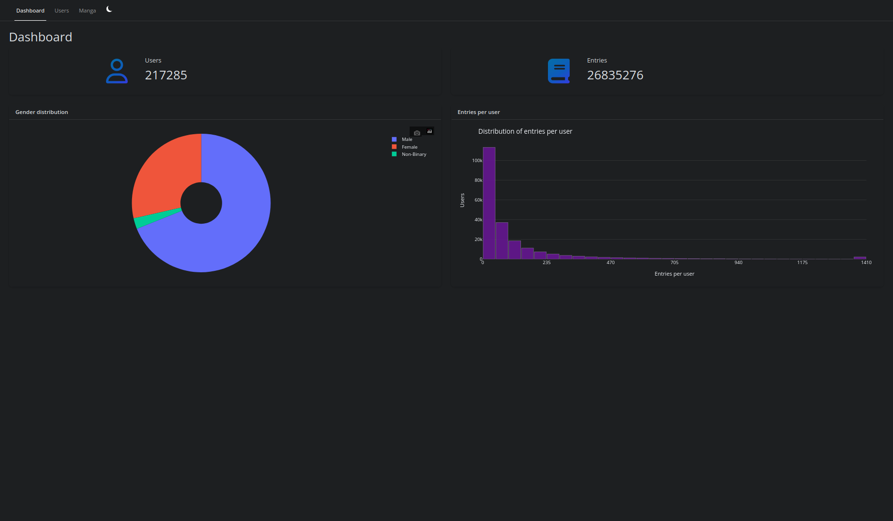
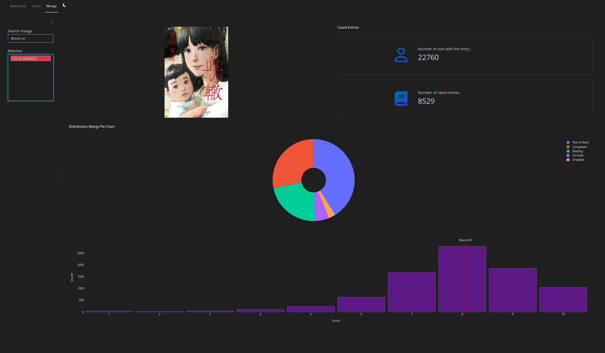

<p align="center">
  
</p>
<h1 align="center">Tsugiwa</h1>
<p align="center">Scraper, API and dashboard for manga data collection and analysis. </p>

<p align="center">
  
</p>

Tsugiwa is a data collection and analysis project aiming to create an end-to-end pipeline that collects manga lists and uses them to build a recommender system.
Currently the project only includes the scraper as well as the system built to query and display the data collected (using an API and a UI).

Anonymization scripts and the recommender system are still a work in progress.

## Contents

- [Requirements](#requirements)
- [Quick Installation](#quick-installation)
  - [Run with docker](#run-with-docker)
  - [Run with python](#run-with-python)
- [Why did I build this project?](#why-did-i-build-this-project)
- [The tech stack](#the-tech-stack)
- [The scraper](#the-scraper)
- [The database](#the-database)
- [The dashboard](#the-dashboard)
- [Credits](#credits)

## Requirements

- [Docker](https://docs.docker.com/get-docker/) with the **Compose plugin** (`docker compose version` must work)
- Git
- Two free ports, one for the API and one for the UI, configurable in `.env`
- About 2 GB of disk for the images and the database built from `data/dump.sql` (64 MB)
- Internet access

Everything else runs inside the containers (`python:3.12.13-slim`). To run without Docker you need Python 3.12.

## Quick Installation

### Run with docker

First, clone the GitHub repository wherever you want:

```bash
git clone https://github.com/Batmath/Tsugiwa.git
cd Tsugiwa
```

Create a `.env` file at the root using the .env.example provided:

```bash
cp .env.example .env
```

Start the API and the dashboard:

```bash
docker compose up --build api ui
```

- Dashboard: http://localhost:7950
- API docs: http://localhost:8014/docs

On the first start, the database is built from `data/dump.sql`. It contains the manga catalogue and 10 anonymized example users, with random gender and birthday, so the dashboard has data right away. This can take a little while.

To collect your own data, start the scraper (see the warning in [Why did I build this project?](#why-did-i-build-this-project) before using it):

```bash
docker compose up --build scraper
```

Stop everything with `docker compose down`.

### Run with python

```bash
git clone https://github.com/Batmath/Tsugiwa.git
cd Tsugiwa

python3.12 -m venv .venv
source .venv/bin/activate   # Windows: .venv\Scripts\activate
pip install -r api/requirements.txt -r ui/requirements.txt -r scraper/requirements.txt -r shared/requirements.txt # For devs : pip install -r ./requirements-dev.txt 
```

Create the `.env` file as described in [Quick Installation](#run-with-docker) (using the `.env.example`). Run every command below **from the repository root**, with the virtual environment activated: the paths in `.env` are relative to where you launch, and the UI starts through the `shiny` command of the venv.

**1. Start the API** (first terminal):

```bash
python -m api.main
```

On the first start, `data/data.db` is built from `data/dump.sql`. This can take a little while. The API docs are at http://localhost:8014/docs.

**2. Start the dashboard** (second terminal):

```bash
python -m ui.app
```

Open http://localhost:7950.

**3. Optional: run the scraper** (third terminal).

```bash
python -m scraper.scraper
```

To add a single user :

```bash
python -m scraper.add_user <username>
```

Stop the API and the dashboard with `Ctrl+C`. Stop the scraper with `pkill -TERM -f scraper.scraper` so the names still waiting in the queue are saved to `pending_recovery`.

## Why did I build this project?

Tsugiwa is a personal project I have been working on in my free time. I like to read a lot (**a lot**), but the recommendations on MyAnimeList aren't the best. Either the recommendations are made by users based on one of your readings (but they don't take into account your list), or recommendations on what to read next based on one manga (again, this doesn't take into account your whole list). My goal was to build a recommendation system that would recommend readings to me, not based on just one manga interaction but on my whole list.

<p align="center">
  <br>
  <em>A sample of my MAL list: ratings are there, but recommendations ignore the whole list.</em>
</p>

But in order to create such a system, I could look at different kinds of data. For instance, information about mangas in general (to build a recommender system that could work on searching semantic proximity in the synopsis of the mangas I've read and new readings), or user interactions with mangas (seeing how people are interacting with different mangas). To answer these data requirements I've built this project with the goal of scraping 500k+ user profiles and experimenting on a recommender system.

While most of the manga data could be obtained directly from the MAL website, no endpoints offered to get user entries without OAuth. Hence I built a scraper to collect data on public profiles. Any data collected will not be sold; an anonymized version of the dataset will be published. Before using this scraper, please contact MAL to discuss its usage as this project is only a showcase.

Another constraint was that the scraping had to be done while not straining MAL servers (to be as respectful as possible). Any significant amount of data collected needs time. And I couldn't leave my computer running that long. Fortunately (or not), I built a small server on which I was running different services using Docker. Hence I chose to build a solution that could run remotely, that would hold persistent data across runs and be accessible via a UI.

## The tech stack

This project was entirely made in Python.

The scraper was made from scratch using multithreading and the data is stored in a SQLite database.
In addition to the scraper, an API was built on top of the SQLite database using FastAPI (allowing me to easily query data or connect the database to other applications), as well as a dashboard using Shiny (the goal wasn't to make anything complex but having a quick way to browse through certain parts of the data).

<p align="center">
  
</p>


These 3 services run in Docker containers to isolate each one, and the API and UI are Reachable in your browser on localhost.

## The scraper

In order to scrape user manga lists from the website, two sources were considered:
- The "User" page which shows the last 20 users connected
- The friend page of each user collected (which can contain a lot of users)

For each user collected, we need to check whether:
- The user's manga list isn't private (in which case we can't collect the user's list)
- The user's manga list contains enough ratings (named entries).

If both conditions are checked, then we can fetch the user's manga list.

While this information could be fetched and executed sequentially (one run to collect x usernames, then another to search for their list if it exists), there are problems with doing it that way.

First, we can't know in advance whether the number of users collected in the first run is enough for our goal (For example, if I want to fetch 10000 user profiles, 800 could be private and 1500 could have fewer than 5 entries, resulting in only 77% of the initial objective achieved).
Secondly, the rate at which the User page of recently connected users changes completely depends on the current traffic on the site and can exceed 10 to 15 seconds (even if most of the time, spamming the refresh button gives a page with 20 different users). 

<p align="center">
  
</p>

Moreover, our goal is to make the process as fast as possible, while not straining the servers more than the average user. I decided to combine both processes by collecting users from the user page, and then exploring their profiles using two threads: One thread (Thread A) fetches names from the User page at a regulated rate and puts them in a shared queue, and the other (Thread B) is in charge of verifying that the manga list can be scraped and doing so when possible. In addition to building the manga lists and adding them to the entries database, if the user currently being analyzed has friends, their names are put in the name queue.

Requests to the user page made by Thread A are controlled by a dynamic sleep timer that varies between 5 seconds and 20 minutes depending on the number of users already in the shared queue (to be processed) and the number of users needed to reach the user goal set, reducing the number of requests made to the website when many users are already analyzed.

In addition to this multithreaded solution, I also added a table in the SQLite database to dump the names of pending profiles if the scraper stops (by itself or from external causes). This allows the scraper to re-use, when it is started, names that had already been discovered instead of searching for new ones.

<p align="center">
  
</p>

> [!WARNING]
> At the moment, users.entries (the total MAL reports) does not always match the number of rows in entries.

## The database

Here is a schema of the database created to store the data of the whole project. The database is nearly normalized to 3NF (manga.demographics is a string that may contain several demographics and needs to be broken down).

The manga table as well as the tables on authors and genres were provided by a script from Jikan API which was discontinued. The data is provided in the `dump.sql`.

The data retrieved from the scraper are stored inside the tables on the left (relationships for the friendships between users, users for the users profile data and entries for the users ratings).

The pending_recovery is used to reload pending and untreated users.

<p align="center">
  
</p>

## The dashboard

I created a simple dashboard to navigate the data available as well as following the data trends. While it has different pages to query different kinds of data (on a specific user or a specific manga), there are more interesting plots to add to this dashboard (and that may be added in future versions, such as heatmaps plotting the presence of genres across entries, or users, etc.)

The dashboard is organized in three pages:

- The general page: presents the general data such as the total number of users and entries fetched until now, the distribution of entries across users and the distribution of genders on the dataset.

<p align="center">
  
</p>

- The user page: presents more precise data on a specific user, which can be looked up by username (later anonymized IDs).

  <p align="center">
    
  </p>

  The user page shows the following plots:
  - A pie plot presenting the proportions of elements such as the different genres, demography targeted or type of media across the user's manga list.
  - A scatter plot comparing user ratings and community ratings (= mean score attributed by ALL users on the platform, not only the dataset) for each of the user's rated entries.
  - A histogram which plots the distribution of scores across a user's entries. These distributions can also be filtered per genre.

  This already allows a quick exploratory analysis on each user's lists. While the screenshots were done using my account, the username will get replaced with individual ids for the public dataset to prevent re-identification.

- The manga page: queries the data specific to a manga.

  <p align="center">
    
  </p>

  This page presents different plots for a specific manga:
  - A pie plot presenting the proportion of each reading status across users in the dataset being built.
  - Count of the number of users with the manga as an entry (rated or non-rated, as well as only rated).
  - A histogram giving the distribution of user ratings with the community mean.

  The manga covers aren't stored locally and are queried directly from MAL. Thus issues may be encountered if you spam switch between different mangas.

## Credits

I thank [MyAnimeList](https://myanimelist.net/) for allowing this project to exist (and for the amazing platform they created for the community). Feel free to create an account there if you want to exchange with the community around your favourite readings! (And I'm always open to recommendations if you have any!)
